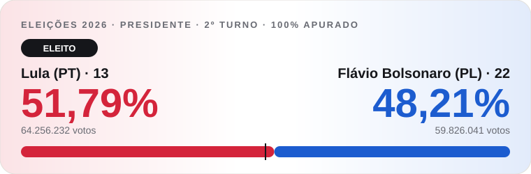
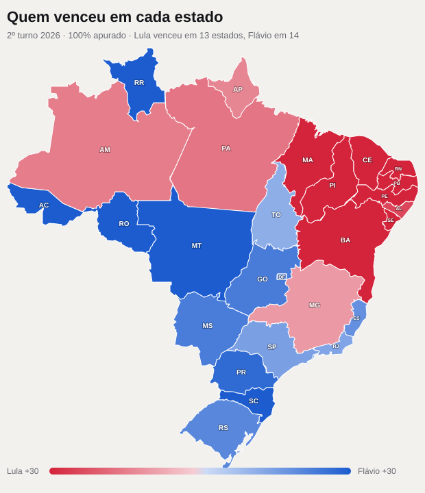

# Apuração ao vivo · 2º turno 2026

Painel que acompanhou em tempo real a apuração do 2º turno da eleição presidencial de 2026 (Lula × Flávio Bolsonaro), com dados oficiais do TSE. Funcionou no ar durante a noite da eleição, atualizando sozinho a cada 30 segundos para quem estava com a página aberta.



## Resultado final

**Lula foi eleito** com **51,79%** dos votos válidos (64.256.232 votos), contra **48,21%** de Flávio Bolsonaro (59.826.041 votos). Diferença de 4.430.191 votos. Comparecimento de 80,78%.



Lula venceu em 13 estados (todo o Nordeste, Pará, Amazonas, Amapá e Minas Gerais). Flávio venceu em 13 estados e no Distrito Federal (Sul, Sudeste exceto Minas, Centro-Oeste e boa parte do Norte). Os números completos de cada estado estão em [`dados/resultado-final.json`](dados/resultado-final.json).

## O que o painel mostrava

- **Placar nacional** com fotos oficiais, porcentagem, votos, diferença e seções apuradas
- **Comparecimento, abstenção, brancos e nulos**
- **Mapa do Brasil** em três modos: quem lidera, urnas apuradas e resultado do 1º turno
- **Mapa por município:** clique duplo num estado abre todas as cidades, pintadas pela vantagem
- **Seção eleitoral por seção:** escolhendo uma cidade, cada urna aparece como um quadradinho na cor de quem venceu ali, lido direto do boletim de urna
- **Faixa de vencedor:** aparece sozinha quando a vantagem fica maior que o número de eleitores das urnas que faltam apurar, ou quando o TSE declara o eleito
- **Por região, tabela dos 27 estados e votos do exterior**
- Contador de visualizações e doação por Pix

## Como funciona

Tudo roda no navegador de quem abre a página, sem servidor próprio:

| Dado | De onde vem |
| --- | --- |
| Resultados por estado e município | `resultados.tse.jus.br/oficial/ele2026/6258/dados/...` (JSON do TSE) |
| Votos de cada urna | Boletins de urna (`arquivo-urna/3221/...`), lidos em formato binário ASN.1 direto no navegador |
| Lista de municípios e seções | Arquivos de configuração do TSE |
| Contorno dos estados e municípios | API de malhas do IBGE |
| Fotos dos candidatos | Fotos oficiais publicadas pelo TSE |

A leitura do boletim de urna foi conferida contra o total oficial: a soma das urnas de um município bateu exatamente com o número divulgado pelo TSE.

## Arquivos

```
index.html               página completa (estilos, mapa, lógica de atualização)
geo.js                   contorno dos 27 estados (IBGE, simplificado)
extra.js                 guia de uso, contagem regressiva, contador de visitas, Pix e ajuste das seções
vitoria.js               faixa de vencedor
dados/resultado-final.json   resultado final de cada estado, exterior e Brasil
img/                     imagens deste README
```

## Rodar no seu computador  

Baixe o repositório e abra o `index.html` no navegador (Chrome, Edge ou Firefox). Como os dados vêm direto do TSE, a página continua mostrando o resultado enquanto o TSE mantiver os arquivos públicos de 2026 no ar.

## Créditos

Dados: Tribunal Superior Eleitoral (TSE) e Instituto Brasileiro de Geografia e Estatística (IBGE). Projeto independente, sem ligação com o TSE, partidos ou candidatos.
